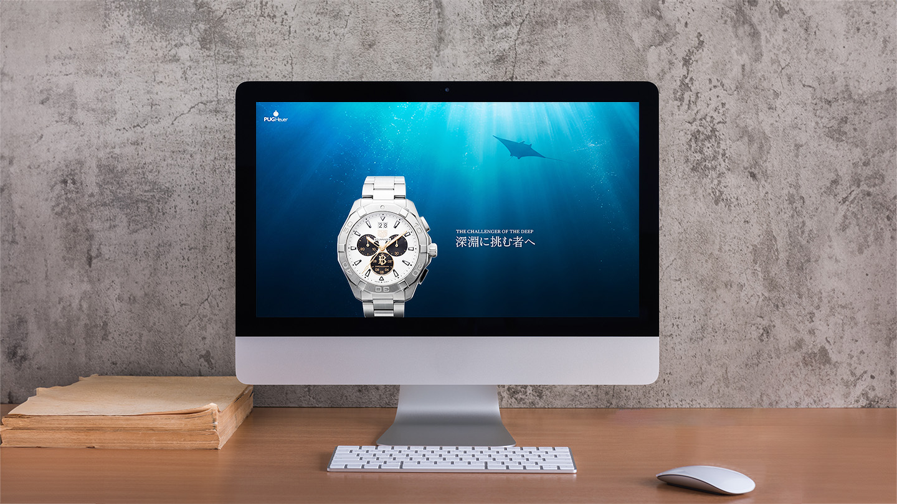
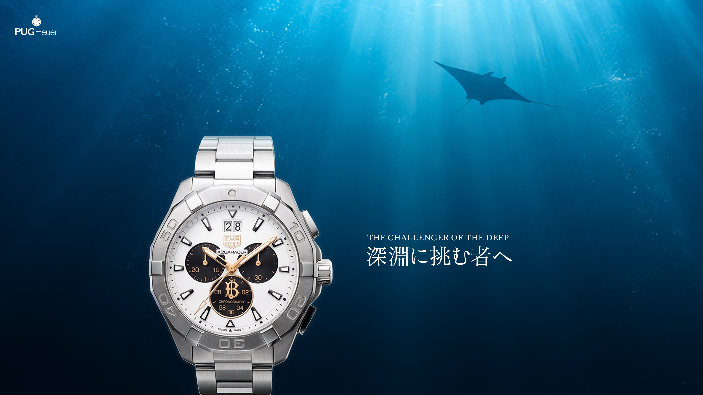

# PUG Heuer — Aquaracer Collection LP

**デザインと技術で、深海への没入体験を表現する。**

架空の高級腕時計ブランドを題材に、海面から深海へと進む世界観を表現した自主制作ランディングページ。



**[Live Demo](https://lp.vector-n.net/)**

企画・構成・デザイン・素材制作・実装・公開まで一貫して担当。Astro、TypeScript、Tailwind CSSを用いて、製品情報の可読性と視覚的な没入感の両立を目指しました。

> **Disclaimer:** 本作品はポートフォリオ用の架空ブランド・非公式コンセプトサイトです。TAG Heuerおよび実在する時計メーカーの公式サイト・公式案件ではありません。

## プロジェクト概要

UI/UXを意識した情報設計と、モダンなフロントエンド技術の実践を目的として制作しました。海中のビジュアルと生成り色の背景を交互に配置し、製品情報の読みやすさと没入感の両立を目指しています。

- **制作形態:** 自主制作（企画・構成・デザイン・ライティング・素材制作・実装・公開）
- **制作期間:** 約1.5か月（企画・画像生成・デザイン・実装を含む）
- **デザイン・素材制作:** Photoshop、Midjourney、Adobe Firefly
- **公開:** Vercel

背景・製品画像は画像生成ツールと画像編集ツールを組み合わせて制作し、懐中時計をモチーフにしたロゴも独自にデザインしました。制作・実装の検討にはAIを補助的に活用しています。

## デザインコンセプト

### THE CHALLENGER OF THE DEEP — 深淵に挑む者へ



海面から差し込む光、海中の奥行き、深海の静けさをモチーフに、スクロールとともに深度が変化するような構成を目指しました。海中の背景と生成り色のセクションを交互に配置し、世界観への没入と製品情報の読みやすさを両立させています。

背景・時計画像はMidjourney、Adobe Firefly、Photoshopを組み合わせて制作。懐中時計をモチーフとしたブランドロゴとコピーも自主制作しました。

## 技術スタック

| 分類               | 技術・ツール                                        |
| ------------------ | --------------------------------------------------- |
| フレームワーク     | Astro 7                                             |
| 言語・スタイル     | TypeScript、HTML、CSS、Tailwind CSS 4               |
| スクロール演出     | Rellax.js、Intersection Observer API、CSS Animation |
| 画像処理・監視     | Sharp、Chokidar、glob                               |
| UI関連（導入済み） | React、shadcn/ui、Base UI、Lucide React             |
| 開発補助           | Prettier、concurrently                              |
| デプロイ           | Vercel                                              |

※ UI関連ライブラリは依存関係として導入済みです。各コンポーネントの実使用状況までは本READMEでは断定していません。

## ページ構成

`src/pages/index.astro` で以下のセクションを順番に配置しています。

1. `Header` — ヘッダー
2. `FirstView` — ファーストビュー
3. `ConceptHybrid` — コンセプト紹介
4. `ExteriorDetail` — 外装のディテール
5. `DialDetails` — 文字盤のディテール
6. `LimitedModel` — 限定モデル
7. `SpecTable` — スペック表
8. `LineUp` — ラインアップ
9. `Footer` — フッター

共通の `Layout.astro` がグローバルCSS、ページタイトル、favicon、パララックス処理の読み込みを担います。`Container.astro` を使ってセクション間のレイアウトを共通化しています。

## 実装上の工夫

### 1. セクション単位のコンポーネント設計

LPをAstroコンポーネントに分割し、各セクションの構成・調整を行いやすくしました。ファーストビューでは背景画像・製品画像・テキストを別要素に分け、画面幅に応じたレイアウトや演出の調整をしやすくしています。

### 2. レスポンシブなパララックス

`src/scripts/parallax.ts` でRellax.jsを初期化します。

- `matchMedia('(min-width: 768px)')` により、768px以上でパララックスを有効化
- 768px未満では `destroy()` で解除
- メディアクエリの `change` イベントで切り替え
- インスタンスの重複生成を防止

### 3. 表示領域に応じた泡のアニメーション

`BubbleOverlay.astro` は、Intersection Observerを用いて泡の生成を制御します。

- 対象領域が表示領域に近づくと、350msごとに泡を生成
- 泡のサイズ（8〜16px）と横位置をランダム化
- CSSアニメーションで上昇させ、8秒後にDOMから削除
- 対象領域を離れると、新しい泡の生成を停止
- `pointer-events: none` で操作を妨げない装飾レイヤーを構成

### 4. 画像アセットの変換・同期

`design-assets` 内の元画像（PNG/JPG/JPEG）を、SharpでWebP（品質80）に変換して `public/images` に出力します。

- `npm run dev` ではAstro開発サーバーとChokidarによる画像監視を並行実行
- 画像の変更時に `sync-images.mjs` を再実行
- `npm run build` の前に `prebuild` で画像同期を実行
- Sharpの内部キャッシュを無効化し、同名画像の上書き更新に対応

**注意:** 同期時には `public/images/*.webp` を一度削除して再生成します。出力先のWebPを手動で編集しないでください。また、異なるフォルダーの元画像でも同じベース名の場合は出力先が重複します。

## ディレクトリ構成

README用の画像は `docs/` に配置しています。サイトで使用する変換済み画像は `public/images/` に出力します。

```text
docs/
├── imac-mockup.jpg
└── main-visual@2x.jpg

src/
├── assets/
├── components/
│   ├── ui/                 # UIコンポーネント（TSX）
│   ├── BubbleOverlay.astro
│   ├── ConceptHybrid.astro
│   ├── Container.astro
│   ├── DialDetails.astro
│   ├── ExteriorDetail.astro
│   ├── FirstView.astro
│   ├── Footer.astro
│   ├── Header.astro
│   ├── LimitedModel.astro
│   ├── LineUp.astro
│   └── SpecTable.astro
├── layouts/
│   └── Layout.astro
├── lib/
│   └── utils.ts
├── pages/
│   └── index.astro
├── scripts/
│   └── parallax.ts
└── styles/
    └── global.css

sync-images.mjs             # 画像変換・同期
watch-images.mjs            # 元画像の変更監視
astro.config.mjs            # Astro / Tailwind / React 設定
```

※ `src/assets` 内の初期テンプレート素材や `Welcome.astro` など、一部の未使用可能性があるファイルは簡略化のため省略しています。

## セットアップ

**必要環境:** Node.js 22.22.0以上（`package.json` の `engines` に準拠）、npm

```bash
npm install
npm run dev
```

`npm run dev` では開発サーバーと画像監視処理が同時に起動します。

| コマンド            | 内容                        |
| ------------------- | --------------------------- |
| `npm run dev`       | Astro開発サーバー＋画像監視 |
| `npm run sync-img`  | 元画像をWebPに同期          |
| `npm run watch-img` | 元画像の変更監視            |
| `npm run build`     | 画像同期後に本番ビルド      |
| `npm run preview`   | ビルド結果をローカルで確認  |

```bash
npm run build
npm run preview
```

画像変換対象は `design-assets/**/*-assets/*.{png,jpg,jpeg}` に一致するファイルです。素材を配置する場合はこのディレクトリ規則にしたがってください。元画像が含まれない環境では、ビルド前の同期処理によって必要なWebP画像が生成されないため注意してください。

## 今後の改善候補

- `prefers-reduced-motion` に応じたアニメーション抑制
- 泡の削除処理を `animationend` に連動させ、CSSとJavaScriptの時間設定を一元化
- 画像同期処理の重複起動防止と、同名ファイルの衝突対策
- パフォーマンス・アクセシビリティの継続的な検証

## 制作について

既存の時計ブランドLPの情報構成を参考にしつつ、海面から深海へと進むストーリー、オリジナルのコピー、ロゴ、生成・加工したビジュアル素材によって独自のコンセプト作品として制作しました。
